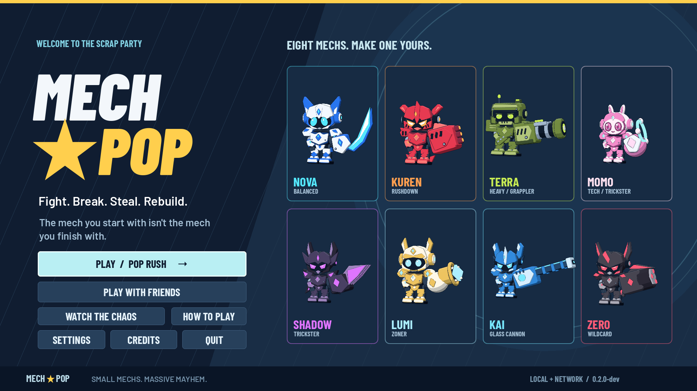
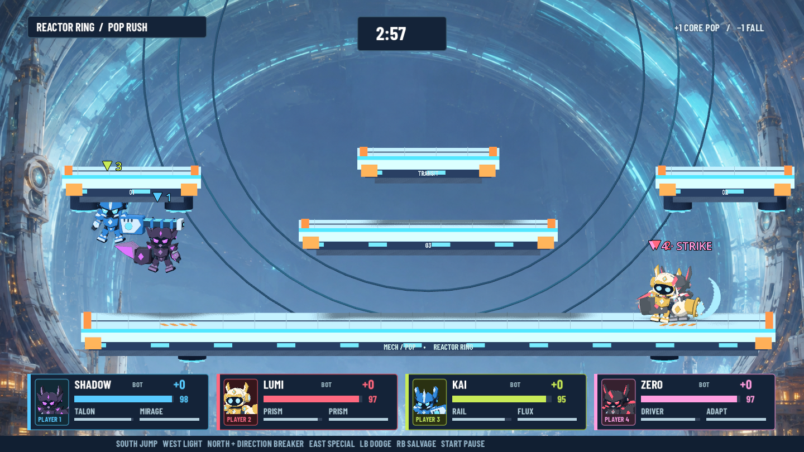

# MECH★POP

**Small mechs. Massive mayhem.**

A colorful, four-player arena fighter built around **FIGHT → BREAK → STEAL → REBUILD → POP**. Knock a weapon loose, grab it, and turn it against its former owner. The mech you start with isn't the mech you finish with.

**[Download the Mac preview](https://github.com/bhaisley/mech-pop/releases/tag/v0.2.0-preview.16)** · [Build from source](docs/BUILD.md) · [Controls](docs/CONTROLS.md) · [Multiplayer](docs/NETWORKING.md)

## The original concept


The original concept that started the project. It shows the broader creative vision; the playable preview's features and platforms are described below.

## 30 seconds of gameplay

<!-- GAMEPLAY_VIDEO -->

https://github.com/user-attachments/assets/4a619f99-ee8e-4185-9b9f-751972ca2b4d

[Download the 30-second MP4](docs/media/gameplay-30s.mp4)

<!-- /GAMEPLAY_VIDEO -->

Actual native gameplay from **macOS build 16**, featuring Nova, Momo, Kai and Zero on Neon Alley. Four bots drive the match. The clip includes the game's music and sound effects.

## From concept to playable game



| Neon Alley | Blossom Core |
| --- | --- |
|  |  |

| SkyPort | Reactor Ring |
| --- | --- |
|  |  |

These are unretouched game renders. [Junk Fields screenshot](docs/media/junk-fields.png) · [Media provenance](MEDIA_PROVENANCE.json)

## What's playable

- **Eight mechs:** Nova, Kuren, Terra, Momo, Shadow, Lumi, Kai and Zero.
- **Five arenas:** SkyPort, Neon Alley, Junk Fields, Blossom Core and Reactor Ring, each with its own battle theme.
- **Modular combat:** eight weapon arms and eight shells that can be broken off, collected and equipped during a fight.
- **Four-player matches:** mix bots, keyboard, touch on iPad and connected controllers using each player's Input selector.
- **Local and network play:** couch matches, direct LAN rooms and private Internet rooms through the included room server.
- **Native macOS and iPad builds:** the preview has been played and tested on both devices.

Build **0.2.0 preview / 16** is a work in progress. Internet play requires a running room server; a permanent public service is not provided. Additional touch, controller reconnection and listening checks remain open. See [testing and known limits](docs/TESTING.md).

## Play

Download the Mac ZIP from [Releases](https://github.com/bhaisley/mech-pop/releases), extract it, and open **MECH POP 0.2.0.app**. Offline play includes its engine, characters, arenas and audio.

Choose **Play / Pop Rush**, pick your mechs and arena, and launch. Each player card has an **Input** button. For a solo controller match, you can set P1 to **Bot** and P2 to **Controller 1**. **Watch the Chaos** runs four bots.

| Action | Keyboard | Controller |
| --- | --- | --- |
| Move / aim | WASD | Left stick / D-pad |
| Jump / double jump | Space | A / Cross |
| Light attack | J | X / Square |
| Directional breaker | K + direction | Y / Triangle + direction |
| Equipped weapon's special | L | B / Circle |
| Dodge / air boost | Shift | Left shoulder |
| Salvage / swap | E | Right shoulder |
| Pause | Esc | Start / Options |

On controller, **A/Cross** edits a setup field and **B/Circle** returns to navigation. Separate **Start** presses join, ready and launch. On iPad, select **Touch** to use the on-screen stick and action buttons.

Wear down an opponent's couplers with light attacks, then land a breaker. Salvage the dropped part to change your special attack. Strip a shell to expose the Core; a **Core Pop** scores a point. Most points after three minutes wins.

The Mac download is a local preview with an ad-hoc signature and is not notarized. iPad builds require your own Apple development signing and device setup; see [iPad setup](docs/IPAD_SETUP.md).

## Build and explore

Open `project.godot` in **Godot 4.7.2 Standard**, or run from the repository root:

```sh
godot --editor --path .
godot --path .
```

The repository includes GDScript source, authored Blender models, runtime assets, original synthesis scripts, accepted lossless music sources, generation prompts and workflows, and regression tests. Development applications and model weights are installed separately.

- [Build instructions](docs/BUILD.md)
- [Architecture](docs/ARCHITECTURE.md)
- [Combat system](docs/COMBAT_SYSTEM.md)
- [Art direction](docs/ART_DIRECTION.md)
- [Room server](server/README.md)
- [Testing and known limits](docs/TESTING.md)

## Made with

**Godot** for the game, **Blender** for the mech models, **SuperCollider** for original sound effects, **MiniMax-Music3** for generated music, **ImageGen** for the stage mattes and construction reference, and **FFmpeg** for audio/video finishing. Tool and asset credits are recorded in the [dependency and asset inventory](docs/THIRD_PARTY_LICENSES.md); notices are included in `third_party/`.

No open-source license has been assigned to the original game code or assets. Third-party components retain their own licenses.
