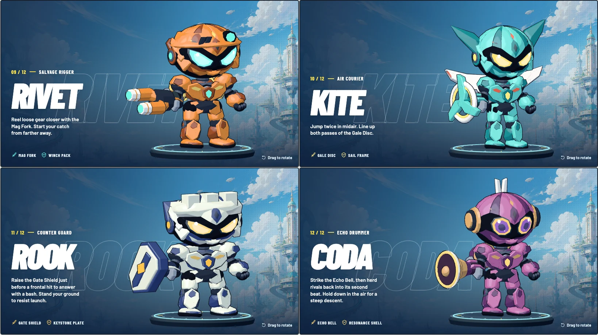
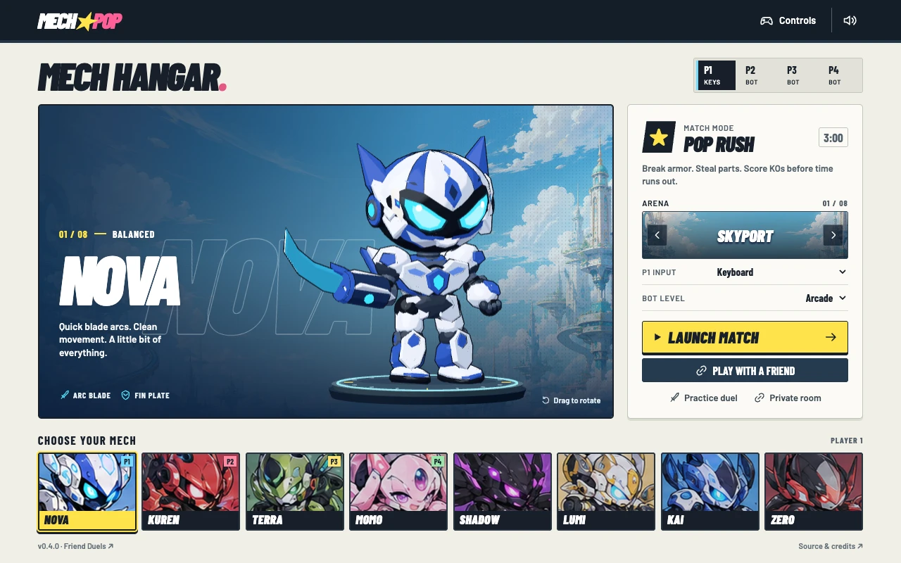
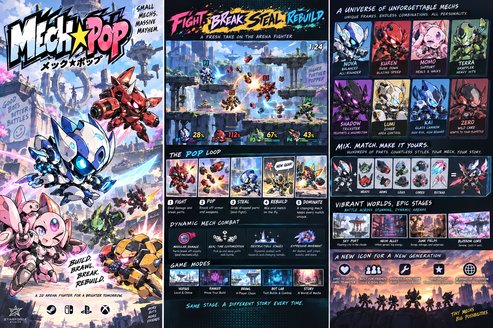
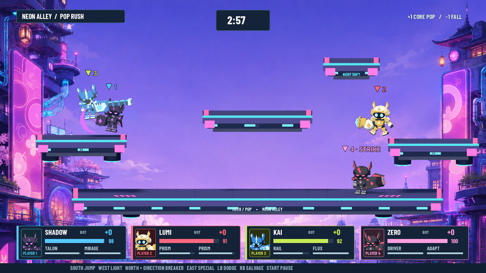
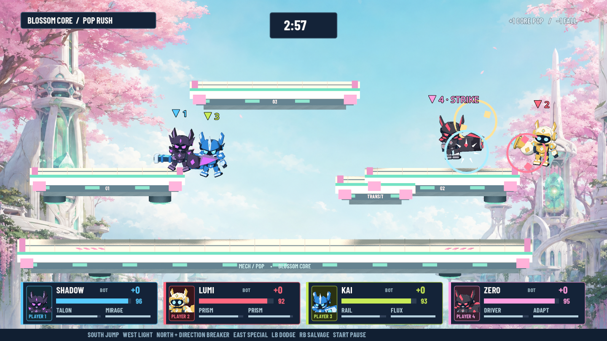
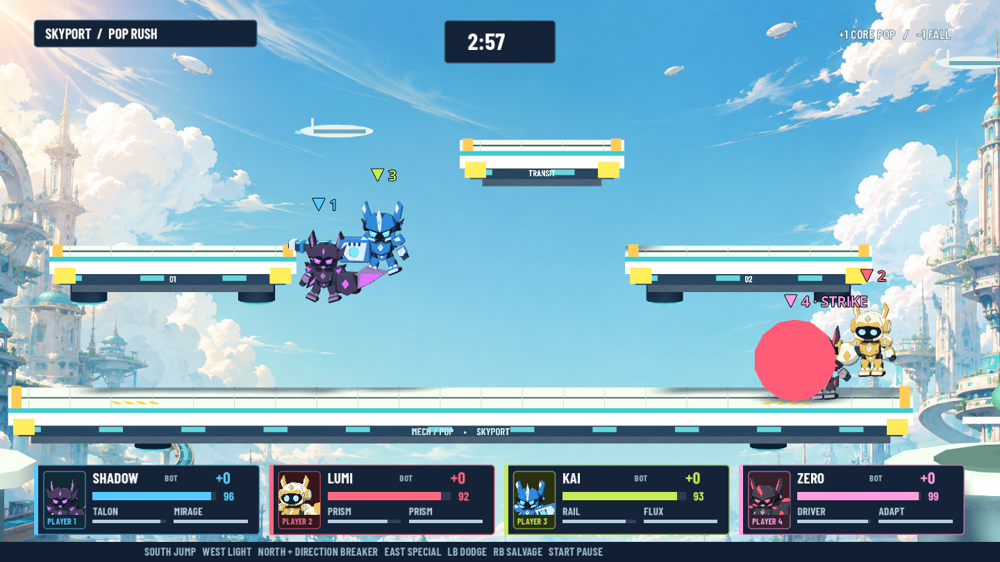

# MECH★POP

**Small mechs. Massive mayhem.**

A colorful, four-player arena fighter built around **FIGHT → BREAK → STEAL → REBUILD → POP**. Knock a weapon loose, grab it, and turn it against its former owner. The mech you start with isn't the mech you finish with.

**[Play MECH★POP in your browser](https://bhaisley.github.io/mech-pop/)** · [Download the Mac preview](https://github.com/bhaisley/mech-pop/releases/tag/v0.2.0-preview.16) · [Build from source](docs/BUILD.md)

## Browser edition

**New Challengers · v0.6.0.** Choose Rivet, Kite, Rook or Coda in the hangar for local matches, Friend Duels and private rooms. Stealing an arm gives you its special. Your chassis keeps its own movement and salvage traits.

| Mech | Chassis trait | Weapon you can steal | Starting shell |
| --- | --- | --- | --- |
| **Rivet** · salvage rigger | Can start a pickup from farther away. | **Mag Fork** pulls a loose part in front of you toward your catch point. Press Salvage to claim it. | Winch Pack |
| **Kite** · air courier | Gets two midair jumps after taking off. | **Gale Disc** can hit once on the way out and once on the way back. Move to change its return path. | Sail Frame |
| **Rook** · counter guard | Resists knockback when standing still on the ground. | **Gate Shield** parries a frontal hit and immediately answers with a bash. The startup and your back are exposed. | Keystone Plate |
| **Coda** · echo drummer | Drops sharply when you hold down while falling. | **Echo Bell** marks the strike location. A second beat hits the same spot 0.48 seconds later. | Resonance Shell |



**Cannon Scramble · v0.5.0.** Choose **Rematch Terra** in the hangar or after winning the practice duel. On Skyport, Terra chases his Pile Cannon, can knock it out of your hands during a catch and can take it back. If he gets there first, break it off again. Win by hitting him with his own cannon.

On the one-handed layout, **S + E** slams the part down close, **E** sends it forward, and **W + E** launches it for an aerial catch. Press **F** within reach of the outlined part. The loose mount opens before it breaks, and the cannon travels to the new pilot’s wrist during the 0.18-second catch. Face Terra and press **R** to fire.

[See the Skyport cannon pickup](docs/media/cannon-scramble.webp)

**Friend Duels · v0.4.0.** Choose **Play with a friend** in the hangar, then **Copy invite**. Your friend opens the link, picks a mech and input, and chooses **Join duel**. The host picks one of eight arenas. When both players press **Ready up**, the round begins. The host’s browser runs the match, so keep the game tab visible. Each round lasts 90 seconds. Win two rounds to take the set. **Rematch** keeps the score, **Switch mech** lets you change chassis between rounds, and **New set** starts you both at 0–0.

To compare pickup controls, open **Controls → How to play** and choose **Try nearest pickup** or **Try aimed pickup**. Both trials put Terra’s cannon and shell within reach. Look for the yellow outline, take the cannon and land a shot. Aimed pickup favors the direction you hold. Neutral input and regular matches use the nearest part. Each trial shows your time to hit and how many other parts you took.

**Cannon Duel · v0.3.0.** Choose **Practice duel** in the hangar to play Nova against Terra on Skyport. Break his Pile Cannon, take it and land a shot with it. You have 90 seconds and can replay immediately.

In any match, move close to a loose part to see its name and your pickup button. Your HUD shows what the equipped weapon does and when its special is ready. The score feed names the scorer and victim of each KO. Tied results show the core damage that decided the round.

Choose a mech, pick an arena and press **Launch match**. The first player uses the keyboard on desktop and on-screen controls on a touchscreen. The other three slots start as bots. Press a button on your controller, then choose it under **P1 input** or the input menu for another player.

The **One-handed WASD** layout puts combat under your left hand. Move with **A/D**, aim with **W/S**, jump with **Space**, and use **Q** for a light attack, **E** for a breaker and **R** for your weapon special. **Shift** dodges and **F** salvages. Open **Controls** in the hangar or pause menu to rebind a key or select the **Classic** layout. Your browser remembers your choice.

[](https://bhaisley.github.io/mech-pop/)

All twelve mechs have articulated Three.js models. The original eight take their silhouettes from the concept poster. Nova carries a curved energy blade, Terra a broad pile cannon and Momo a ring-shaped caster. All twelve weapon arms and twelve shells detach, land in the arena and fit the mech that salvages them. The original combat simulation, bots and room protocol run in WebAssembly.

The browser edition has eight arenas. Tideglass Station has a crossing shuttle, Cinder Foundry has a furnace piston and Aurora Relay has a diagonal cable lift. Their YuE2 tracks are *Pressure Hull*, *Ladle Run* and *Carrier Wave*. Each chassis has its own attack, impact, boost and Core Pop sounds. Directional sparks, shell flashes and a hexagonal shield show how a hit landed. For network play, **Private room** connects to a running room server. [Browser gameplay screenshot](docs/media/browser-battle.webp) · [Browser assets and credits](docs/game/assets/CREDITS.md) · [Room server setup](server/README.md)

## The original concept



The original concept that started the project. It shows the broader creative vision; the playable preview's features and platforms are described below.

## 30 seconds of native gameplay

<!-- GAMEPLAY_VIDEO -->

https://github.com/user-attachments/assets/4a619f99-ee8e-4185-9b9f-751972ca2b4d

[Download the 30-second MP4](docs/media/gameplay-30s.mp4)

<!-- /GAMEPLAY_VIDEO -->

Actual native gameplay from **macOS build 16**, featuring Nova, Momo, Kai and Zero on Neon Alley. Four bots drive the match. The clip includes the game's music and sound effects.

## From concept to playable game


| Neon Alley | Blossom Core |
| --- | --- |
|  |  |

| SkyPort | Reactor Ring |
| --- | --- |
|  |  |

These are unretouched game renders. [Junk Fields screenshot](docs/media/junk-fields.png) · [Media provenance](MEDIA_PROVENANCE.json)

## What's playable

- **Twelve playable mechs.** Nova, Kuren, Terra, Momo, Shadow, Lumi, Kai, Zero, Rivet, Kite, Rook and Coda.
- The current browser game and source include eight arenas with individual battle themes. Native preview build 16 includes the original five.
- **Modular combat.** Twelve weapon arms and twelve shells that can be broken off, collected and equipped during a fight.
- **Four-player matches:** mix bots, keyboard, touch on iPad and connected controllers using each player's Input selector.
- **Local and network play:** couch matches, direct LAN rooms and private Internet rooms through the included room server.
- **Native macOS and iPad builds:** the preview has been played and tested on both devices.

Build **0.2.0 preview / 16** is a work in progress. Internet play requires a running room server; a permanent public service is not provided. Additional touch, controller reconnection and listening checks remain open. See [testing and known limits](docs/TESTING.md).

## Native preview

Download the Mac ZIP from [Releases](https://github.com/bhaisley/mech-pop/releases), extract it, and open **MECH POP 0.2.0.app**. Offline play includes its engine, characters, arenas and audio.

Choose **Play / Pop Rush**, pick your mechs and arena, and launch. Each player card has an **Input** button. For a solo controller match, you can set P1 to **Bot** and P2 to **Controller 1**. **Watch the Chaos** runs four bots.

| Action | Keyboard | Controller |
| --- | --- | --- |
| Move / aim | WASD | Left stick / D-pad |
| Jump / double jump | Space | A / Cross |
| Light attack | J | X / Square |
| Directional breaker | K + direction | Y / Triangle + direction |
| Equipped weapon's special | L | B / Circle |
| Dodge / air boost | Shift | Left shoulder |
| Salvage / swap | E | Right shoulder |
| Pause | Esc | Start / Options |

On controller, **A/Cross** edits a setup field and **B/Circle** returns to navigation. Separate **Start** presses join, ready and launch. On iPad, select **Touch** to use the on-screen stick and action buttons.

Wear down an opponent's couplers with light attacks, then land a breaker. Salvage the dropped part to change your special attack. Strip a shell to expose the Core; a **Core Pop** scores a point. Most points after three minutes wins.

The Mac download is a local preview with an ad-hoc signature and is not notarized. iPad builds require your own Apple development signing and device setup; see [iPad setup](docs/IPAD_SETUP.md).

## Build and explore

Open `project.godot` in **Godot 4.7.2 Standard**, or run from the repository root:

```sh
godot --editor --path .
godot --path .
```

The repository includes GDScript source, authored Blender models, runtime assets, original synthesis scripts, accepted lossless music sources, generation prompts and workflows, and regression tests. Development applications and model weights are installed separately.

- [Build instructions](docs/BUILD.md)
- [Architecture](docs/ARCHITECTURE.md)
- [Combat system](docs/COMBAT_SYSTEM.md)
- [Art direction](docs/ART_DIRECTION.md)
- [Room server](server/README.md)
- [Testing and known limits](docs/TESTING.md)

## Made with

**Three.js** draws the browser edition. **Godot** runs the shared combat simulation and native game. The project uses **Blender** for the native mech models, **SuperCollider** for original sound effects, **MiniMax-Music3** and **YuE2-3B** for music, **ImageGen** for the stage mattes and construction reference, and **FFmpeg** for audio and video finishing. [Dependency and asset inventory](docs/THIRD_PARTY_LICENSES.md)

No open-source license has been assigned to the original game code or assets. Third-party components retain their own licenses.
