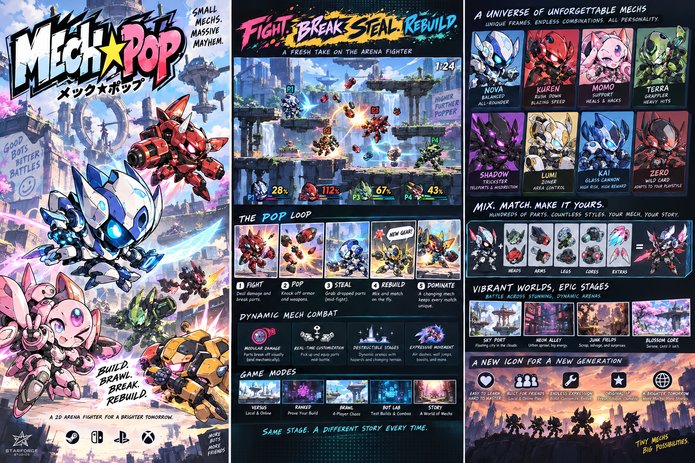

# Art direction and reference analysis

> Design reference. See the [project README](../README.md) for the features and platforms available in the current preview.

## What the supplied poster establishes

The original 1536 × 1024 poster combines a large character illustration on the left, a compact battle/product panel in the middle and an eight-character roster on the right. Its appeal comes from the contrast between huge expressive heads and dense little machines, sharp black contours and luminous color, and friendly proportions posed with explosive force.

Translate these qualities into the game: white/cobalt Nova with swept fins; hot red Kuren with aggressive forward wedges; olive/lime Terra with heavy shoulders; pink/white Momo with round eye screens and split antennae. Use deep navy mechanical joints, hard shadow bands, small bright bevel accents and color-coded energy. Broken equipment must preserve the same design vocabulary as the equipped model.

The poster is visually dense because it sells the whole IP. The playable camera needs more negative space, larger characters relative to its HUD and fewer simultaneous callouts. Its percentage meters, extra modes, platform logos, Japanese lettering and studio mark are not approved product requirements. Reconstruct the MECH★POP title as a clean original graphic; do not ship the entire poster as the game interface.

## Construction rules

- Target roughly 2.4–2.8 head heights overall. Head width and eye shapes carry identity at small scale. Terra can be a little taller and much broader; Momo stays compact enough for an oversized cannon to be funny.
- Every model has three silhouette landmarks that survive weapon loss. Avoid relying on paint alone. Use original crescent, vent, fortress and petal motifs instead of copying commercial mecha head crests or insignia.
- Hard surfaces use bevels, intentional plane changes and controlled normals. Avoid random panel lines and generic stacks of cylinders. Dark joints separate larger armor masses.
- Use two or three deliberate light bands, a narrow rim, graphic eye emission and restrained specular accents. Outline thickness should be stable enough at combat zoom; test a hull outline before adding expensive screen-space methods.
- Keep face eyes readable during silhouette changes. Expressions: calm, determined, impact squint, missing-part surprise, critical flicker and victory. No full-screen facial close-ups during active multiplayer.
- Character animation includes anticipation, decisive poses and follow-through. Squash and stretch belongs mainly to pose/rig offsets and effects; mechanical hinges remain believable.

## Palette specification

These are proposed production colors derived by visual interpretation of the reference, not sampled canonical values.

| Role | Colors | Shape / second cue |
| --- | --- | --- |
| Ink / structure | `#101824`, `#253246` | Strong exterior contours and readable joints |
| Armor white | `#EFF6FF` | Large clean plates, cool shadow planes |
| Nova | `#2875EF`, `#54E8FF` | Crescent fins, narrow energy arcs |
| Kuren | `#EF3D58`, `#FF9F50` | Forward wedges, jagged burst cones |
| Terra | `#718B38`, `#C7EB53` | Broad blocks, piston rings and kinetic dust |
| Momo | `#F691CC`, `#FFE1F0` | Petal rounds, dotted tethers and halo geometry |
| Salvage | `#FFD950` | Bolt/connector icon, ground ring and stable outline |
| Confirmed impact | Near-white | Directional starburst, very short duration |
| Critical Core | `#EF4FE7` with ink | Cracked diamond, warning pulse and audio cue |

Player identity uses persistent numbers and distinct marker shapes as well as color, because any player can select any chassis. A stolen green cannon remains green on pink Momo; it must not be recolored into an unrecognizable generic upgrade.

## Stage and interface hierarchy

Sky Port uses warm ivory platforms against cool sky, with peach/purple atmospheric city layers. Active platforms get the sharpest environmental edges; distant architecture has softer contrast. A giant ring and passing transport provide memorable landmarks without crossing the fighters' silhouettes at full contrast. Debris and foliage cannot conceal salvage.

Branding uses a yellow star, white MECH, pink POP, ink shadows and a restrained cyan accent. Use manga panel cuts, halftone in quiet areas and a bold display face paired with a highly legible condensed HUD face. Select fonts only after checking their exact licenses. Keep menu text real and editable; generated art must not bake in important labels.

The title/select/results may be illustration-rich. During combat, reserve large typographic emphasis for important POP events. Design the HUD at 1920 × 1080 with a 5% safe area and aim for about 24 px minimum essential text; verify at television distance. Handle the Mac's 16:10 display with stable aspect/safe framing rather than stretching artwork.

## Visual acceptance

Before producing all art, review one complete mech and the large cannon on a small host in the actual Godot camera. Then test all four as black silhouettes and with every donor weapon attached, at the minimum intended zoom. Inspect material response, attachment gaps, action silhouettes, mixed loadouts, empty sockets and critical cores. Concept sheets alone cannot pass this gate.
