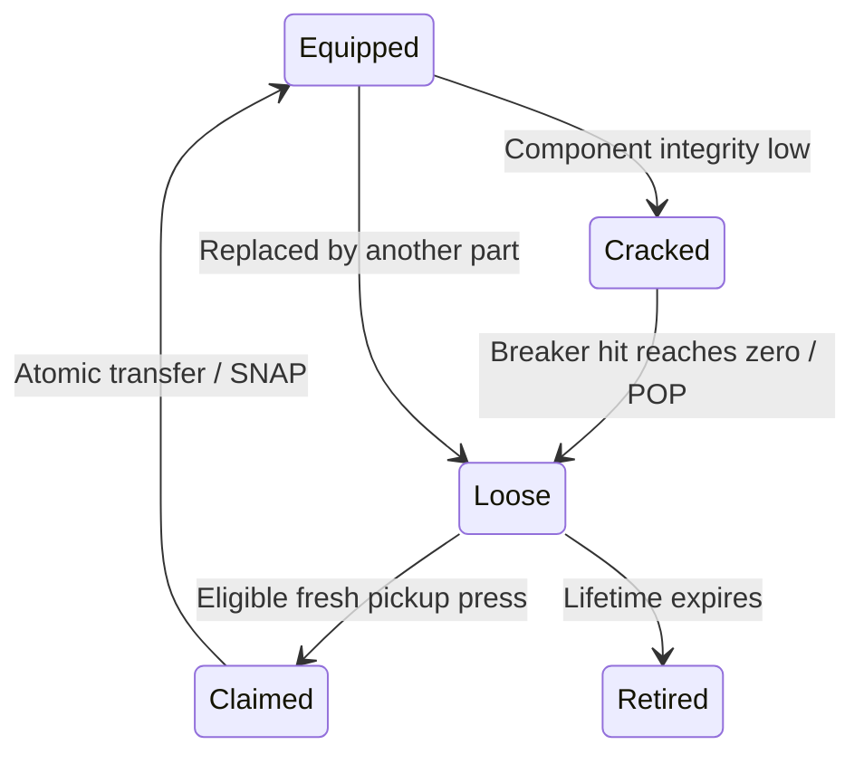

# POP / steal / rebuild

> Design reference. See the [project README](../README.md) for the features and platforms available in the current preview.

## Curated modular contract

Each chassis has two detachable slots: `weapon_arm` and `shell`. Permanent head, legs, core housing and the off-hand retain character identity. A weapon changes the special action; a shell changes one modest defensive or movement modifier with a tradeoff. No part may remove access to base recovery.

Native shell proposals: Nova's fin plate improves air steering with lighter knockback resistance; Kuren's vent shell improves ground acceleration with weaker armor; Terra's bulwark improves resistance but reduces acceleration; Momo's halo shell extends hover while increasing recoil. Numbers follow the first compatibility playtest.

Weapon meshes retain donor colors and recognizable scale. Momo does not shrink Terra's cannon to the size of her original arm. Socket adapters handle wrist height, elbow clearance and grip pose; the cannon's physical length remains a feature.

## State and ownership

A part instance has a unique ID, definition ID, original donor, current carrier or loose state, condition, drop reason and lifetime. Exactly one carrier or salvage entity owns it. Visual meshes follow ownership; moving a mesh cannot change ownership by itself.

Break once: remove the gameplay modifier and special, expose the socket, create one loose instance at the attachment point and emit one typed event. Start the part on a visible directional ballistic arc. Loose motion uses controlled 2D collisions and cosmetic 3D spin; no uncontrolled 3D physics can carry it out of the combat plane.

After a 150 ms separation grace period, any fighter can collect it, including the original owner. Loose salvage persists initially for 14 seconds, settles to a readable pose and shows a yellow outline/ground ring. It remains recognizable by donor shape and color. A part falling outside recoverable space may return once to the nearest safe salvage rack, with a visible recall trail; a second loss retires it. Cap the field at eight loose parts, retiring the oldest unclaimed part predictably.

## One-button rebuilding

A fresh salvage press selects the nearest eligible part in roughly a one-body-width radius, with a preview icon. Air catches are allowed. Claim resolution uses distance, then a deterministic tie policy; two players never receive the same instance. Bots submit the same request as players.

The claim commits through a short approximately 180 ms attach action. The claimant is vulnerable. Before commit, interruption releases the reservation; at commit, ownership, slot data and special action change atomically. A full slot ejects the old part with its actual remaining condition. Emit SNATCH for stealing, SNAP for equipping or a compact combined local cue; avoid stacking several large text banners for one action.

A genuinely broken part gets a fresh coupler worth 50% of its definition's integrity on its next rebuild. Consume that allowance once. Simply dropping, swapping or reclaiming an intact part never repairs it. Rebuilding does not heal Core. This prevents rapid pickup/drop loops from becoming an infinite heal.

An equipped part lasts until it breaks, is replaced or the carrier CORE POPs. That is the temporary rebuild: it belongs to this match, not a permanent loadout unlock. Avoid an additional arbitrary battery timer in the first slice. Character-specific heat/cooldown rules still travel with the weapon.

On CORE POP, release at most the surviving equipped weapon as salvage; the shell becomes cosmetic fragments. Existing stolen/loose parts remain valid. Respawn creates new, uniquely identified native equipment; it never recalls a part from another player. Additional native parts after respawn are intentional new instances, bounded by salvage lifetime and the field cap.

## Spectator comprehension and balance gates

Every real arm POP must show: separating mesh, empty socket, sparks, changed special icon, a visible loose collectible and a short contextual cue. Every equip must show: attachment motion, changed silhouette, updated special icon and the new attack when pressed. Core exposure must be visible on the body without reading the HUD.

Test the original owner's recovery, a rival steal, replacing a full slot, interrupting attachment, two simultaneous claims, a second break, a carrier KO, respawn, expiration and reset. A conservation check tracks every unique instance through those transitions. Also test all 16 weapon/chassis and 16 shell/chassis fits; a successful visual attachment does not prove the new move, recoil, condition and cooldown work.
